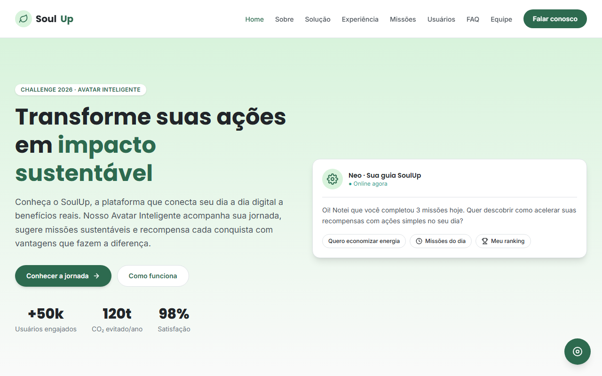
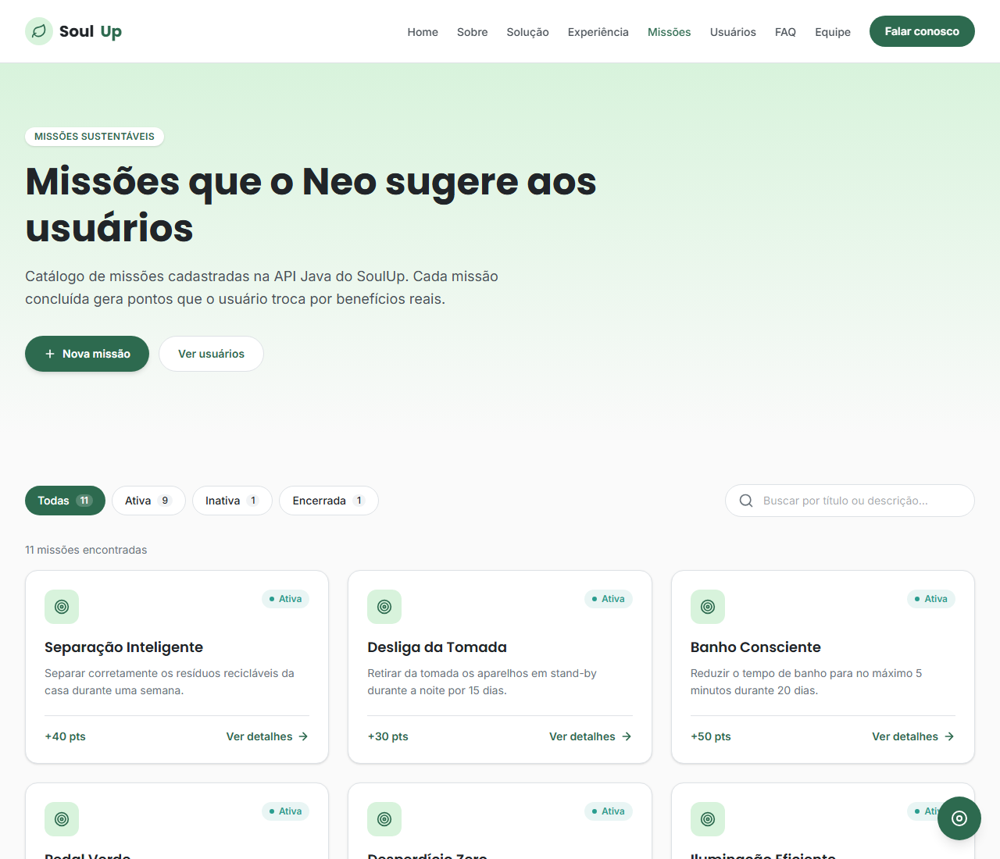
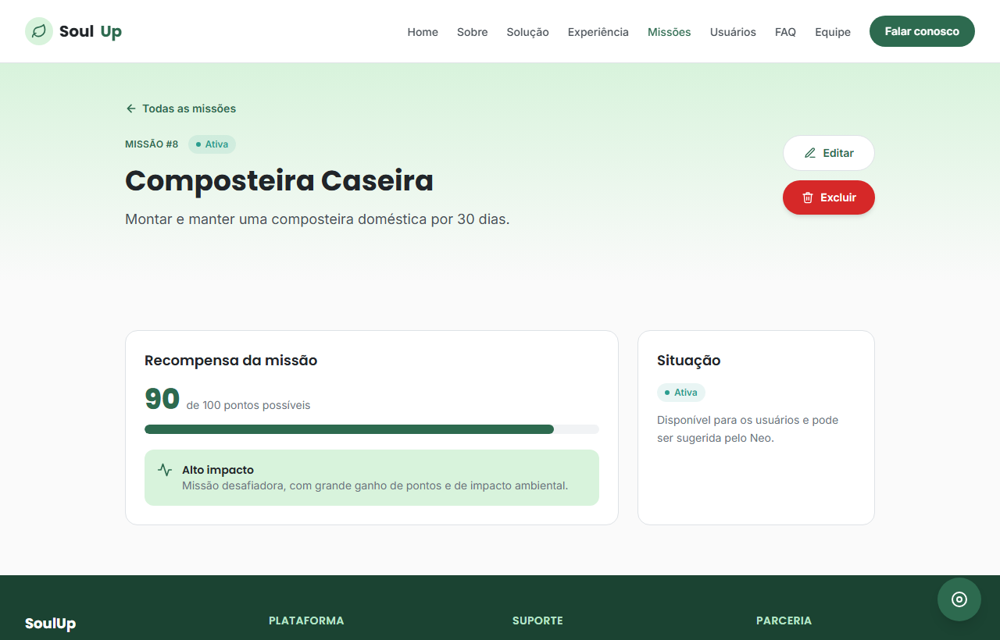
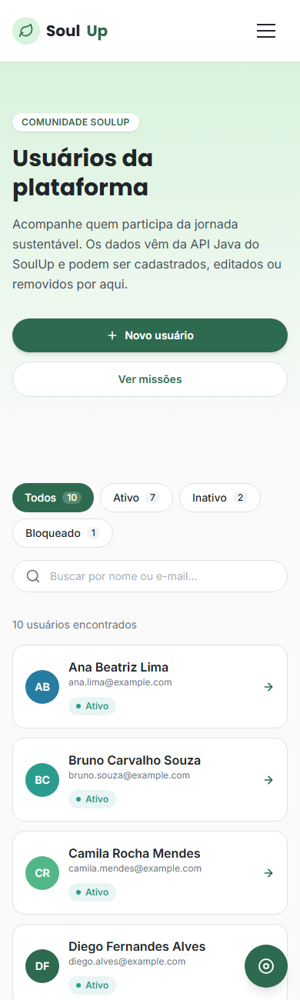

<p align="center">
  
</p>

# SoulUp — Avatar Inteligente e Interativo

> **Challenge 2026 — FIAP × Prospera**
> **Turma:** 1TDSPK (Fevereiro) · **Equipe:** Ecoeye

O **SoulUp** é um ecossistema digital sustentável que conecta o engajamento diário de usuários a benefícios físicos e econômicos reais, como descontos diretos na fatura de energia elétrica. A personagem **Neo** atua como um guia gamificado que realiza onboarding personalizado, sugere missões ecológicas de forma contextual e gerencia o progresso e as recompensas dos usuários.

Na **Sprint 4**, a Single Page Application em **React + Vite + TypeScript** passou a consumir a **API REST desenvolvida em Java** (disciplina *Domain Driven Design Using Java*). As páginas de **Missões** e **Usuários** listam, detalham, cadastram, editam e excluem registros gravados no banco de dados Oracle (disciplina *Building Relational Database*).

---

## 🚀 Como usar

| Recurso | Link |
| --- | --- |
| 💻 Repositório no GitHub | [github.com/Suzart007/ecoeye-soulup](https://github.com/Suzart007/ecoeye-soulup) |
| 🎬 Vídeo de apresentação (YouTube) | _inserir o link do vídeo_ |
| 🌐 Aplicação publicada na Vercel | _inserir a URL do deploy_ |
| ☕ API Java publicada | _inserir a URL da API_ |

### Executando localmente

Pré-requisitos: [Node.js](https://nodejs.org/) 18+ e npm.

```bash
# 1. Clone o repositório
git clone https://github.com/Suzart007/ecoeye-soulup.git
cd ecoeye-soulup

# 2. Instale as dependências
npm install

# 3. Informe a URL da API Java
cp .env.example .env.local   # depois edite VITE_API_URL

# 4. Rode o servidor de desenvolvimento
npm run dev
```

A aplicação abre em `http://localhost:5173`.

| Comando | O que faz |
| --- | --- |
| `npm run dev` | Servidor de desenvolvimento com recarregamento automático |
| `npm run build` | Checagem de tipos (TypeScript) + build de produção em `dist/` |
| `npm run preview` | Serve o build de produção localmente |

### Variável de ambiente

| Variável | Descrição | Exemplo |
| --- | --- | --- |
| `VITE_API_URL` | URL base da API Java, sem barra no final. Se não for definida, o front usa `http://localhost:8080`. | `https://soulup-api.onrender.com` |

### Deploy na Vercel

1. Importe o repositório na Vercel (o preset **Vite** é detectado automaticamente: build `npm run build`, saída `dist`).
2. Em **Settings → Environment Variables**, cadastre `VITE_API_URL` com a URL pública da API Java e faça um novo deploy.
3. O arquivo [`vercel.json`](vercel.json) redireciona todas as rotas para o `index.html`, permitindo abrir ou recarregar diretamente URLs como `/missoes/3`.

---

## 🛠️ Tecnologias utilizadas

| Tecnologia | Uso no projeto |
| --- | --- |
| **React 18** | Interface, componentização e hooks (`useState`, `useEffect`, `useContext`, `useMemo`) |
| **Vite** | Build e ambiente de desenvolvimento |
| **TypeScript** | Tipagem estática: interfaces, union types, intersection types e tipos genéricos |
| **Tailwind CSS v4** | Estilização e responsividade de toda a interface (`sm:`, `md:`, `lg:`, `xl:`) |
| **React Router DOM** | Navegação SPA, rotas estáticas, rotas dinâmicas (`:id`) e query params |
| **React Hook Form** | Validação dos formulários de contato, missões e usuários |
| **Fetch API** | Requisições HTTP nativas à API Java (GET, POST, PUT e DELETE) |
| **API REST em Java** | Back-end com as regras de negócio e a persistência no banco Oracle |
| **Vercel** | Deploy e hospedagem do front-end |
| **Git & GitHub** | Versionamento e histórico de desenvolvimento |

Sem bibliotecas de UI (Bootstrap, Material UI, Chakra UI), sem Axios e sem templates prontos — apenas as tecnologias acima, conforme as regras do Challenge.

---

## 📂 Estrutura de pastas

```
ecoeye-soulup/
├── public/
│   ├── favicon.svg
│   └── team/                    # Fotos dos integrantes
├── src/
│   ├── components/
│   │   ├── common/              # Button, PageHero, StatusBadge, FilterChips, SearchField, BackLink...
│   │   ├── contact/             # ContactForm, ContactChannelCard
│   │   ├── faq/                 # FaqAccordionItem
│   │   ├── feedback/            # LoadingState, ErrorState, EmptyState, ConfirmDialog, RedirectNotice
│   │   ├── form/                # FormField e FormPageLayout (base dos formulários)
│   │   ├── icons/               # Ícones SVG autorais
│   │   ├── layout/              # Header, Footer, Layout (Outlet)
│   │   ├── missoes/             # MissaoCard, MissaoForm
│   │   ├── neo/                 # NeoChatWidget
│   │   ├── team/                # TeamMemberCard
│   │   └── usuarios/            # UsuarioList (tabela/cards), UsuarioForm, UsuarioAvatar
│   ├── context/                 # ToastContext + ToastProvider (notificações globais)
│   ├── data/                    # Dados estáticos (navegação, equipe, FAQ, situações)
│   ├── hooks/                   # useApi, useIdParam, useToast, useDocumentTitle, useScrollReveal
│   ├── pages/                   # Uma página por rota
│   ├── services/                # api.ts (cliente HTTP) + missoesService + usuariosService
│   ├── types/                   # index.ts (tipos de interface) e api.ts (tipos da API)
│   ├── utils/                   # Formatação de datas e textos
│   ├── App.tsx                  # Definição das rotas
│   ├── main.tsx                 # Entry point (BrowserRouter + ToastProvider)
│   └── index.css                # Tailwind + design tokens do projeto
├── .env.example                 # Modelo da variável VITE_API_URL
├── vercel.json                  # Rewrites da SPA para a Vercel
├── index.html
├── package.json
├── tsconfig.json / tsconfig.app.json / tsconfig.node.json
└── vite.config.ts
```

---

## 🗺️ Páginas e rotas

| Rota | Página | Tipo |
| --- | --- | --- |
| `/` | Home | Estática (`/home` redireciona para cá) |
| `/sobre` | Sobre o projeto | Estática |
| `/solucao` | Nossa Solução | Estática |
| `/experiencia` | Experiência do Usuário | Estática |
| `/missoes` | Missões — listagem com filtro (`?situacao=ATIVA`) e busca (`?busca=`) | Estática + **GET** na API |
| `/missoes/nova` | Cadastro de missão | Estática + **POST** na API |
| `/missoes/:id` | Detalhe da missão, com exclusão | **Dinâmica** + **GET / DELETE** |
| `/missoes/:id/editar` | Edição da missão | **Dinâmica** + **GET / PUT** |
| `/usuarios` | Usuários — tabela (desktop) ou cards (mobile), com filtro e busca | Estática + **GET** na API |
| `/usuarios/novo` | Cadastro de usuário | Estática + **POST** na API |
| `/usuarios/:id` | Perfil do usuário + sugestões do Neo | **Dinâmica** + **GET / DELETE** |
| `/usuarios/:id/editar` | Edição do usuário | **Dinâmica** + **GET / PUT** |
| `/faq` | Perguntas Frequentes | Estática |
| `/contato` | Contato | Estática |
| `/integrantes` | Equipe | Estática |
| `/integrantes/:id` | Perfil do integrante | **Dinâmica** |
| `*` | Página 404 | — |

Nas rotas dinâmicas, o parâmetro `:id` é validado antes da requisição. Se for inválido ou se a API responder **404**, o usuário vê uma mensagem personalizada e é redirecionado para a listagem após uma contagem regressiva. Cadastros, edições e exclusões exibem notificações (toasts) de sucesso ou erro.

---

## 🔌 Integração com a API Java

Todas as chamadas HTTP ficam na pasta `src/services` — nenhum componente chama `fetch` diretamente:

- **`api.ts`** — cliente HTTP com `fetch`: lê `VITE_API_URL`, envia/recebe JSON, aplica *timeout* de 15 s, cancela requisições quando a página é fechada e converte falhas em mensagens amigáveis (sem conexão, 404, 409, 400/422, 5xx).
- **`missoesService.ts`** e **`usuariosService.ts`** — uma função por endpoint (`listar`, `buscar`, `criar`, `atualizar`, `excluir`).
- **`hooks/useApi.ts`** — hook que expõe o estado da requisição como um *union type* (`loading` | `error` | `success`), usado pelas páginas para exibir carregamento, erro (com botão "Tentar novamente") e lista vazia.

### Endpoints consumidos

| Método | Endpoint | Uso no front-end | Resposta esperada |
| --- | --- | --- | --- |
| `GET` | `/missoes` | Listagem de missões e sugestões do Neo | `200` + array de missões |
| `GET` | `/missoes/{id}` | Detalhe e edição | `200` + missão · `404` se não existir |
| `POST` | `/missoes` | Cadastro | `201` + missão criada (com `id`) |
| `PUT` | `/missoes/{id}` | Edição | `200` + missão (ou `204`) |
| `DELETE` | `/missoes/{id}` | Exclusão | `204` |
| `GET` | `/usuarios` | Listagem de usuários | `200` + array de usuários |
| `GET` | `/usuarios/{id}` | Perfil e edição | `200` + usuário · `404` se não existir |
| `POST` | `/usuarios` | Cadastro | `201` + usuário criado · `409` se o e-mail já existir |
| `PUT` | `/usuarios/{id}` | Edição | `200` + usuário (ou `204`) |
| `DELETE` | `/usuarios/{id}` | Exclusão | `204` |

### Formato dos dados (JSON)

Os campos seguem as tabelas `TB_MISSOES` e `TB_USUARIOS` do banco da Sprint 4. Os tipos estão em [`src/types/api.ts`](src/types/api.ts).

```jsonc
// Missão
{ "id": 3, "titulo": "Banho Consciente", "descricao": "Reduzir o tempo de banho para no máximo 5 minutos durante 20 dias.", "pontuacao": 50, "situacao": "ATIVA" }

// Usuário
{ "id": 1, "nome": "Ana Beatriz Lima", "email": "ana.lima@example.com", "dataCadastro": "2026-01-12", "situacao": "ATIVO" }
```

- `situacao` da missão: `ATIVA`, `INATIVA` ou `ENCERRADA` · `pontuacao`: inteiro de 0 a 100.
- `situacao` do usuário: `ATIVO`, `INATIVO` ou `BLOQUEADO` · `dataCadastro`: `AAAA-MM-DD` (o front envia a data de hoje no cadastro).
- Mensagens de erro da API em `{ "mensagem": "..." }` ou `{ "message": "..." }` são exibidas ao usuário em respostas 4xx.
- A API precisa liberar **CORS** para a URL da Vercel e para `http://localhost:5173` (no Quarkus: `quarkus.http.cors=true`).

---

## 🖼️ Imagens e ícones

- **Favicon** (`public/favicon.svg`): folha estilizada com a identidade verde da Ecoeye.
- **Ícones**: biblioteca própria de ícones SVG em `src/components/icons/Icons.tsx` (missões, usuários, ações de editar/excluir, alertas e navegação), sem dependências externas.
- **Fotos da equipe**: `public/team/`.

| Home | Missões |
| --- | --- |
|  |  |

| Detalhe da missão | Usuários no celular |
| --- | --- |
|  |  |

---

## 👥 Autores e créditos

| Foto | Integrante | RM | Turma | LinkedIn | GitHub |
| --- | --- | --- | --- | --- | --- |
|  | Guilherme Souza Suzart | 569884 | 1TDSPK | [LinkedIn](https://www.linkedin.com/in/guilherme-suzart-ba83193b3) | [@Suzart007](https://github.com/Suzart007) |
|  | Kaio Marcus Macedo Chiappinelli | 573365 | 1TDSPK | [LinkedIn](https://www.linkedin.com/in/kaio-chiappinelli-183106322) | [@KaioChiappinelli](https://github.com/KaioChiappinelli) |
|  | Matheus Vecchi | 569749 | 1TDSPK | [LinkedIn](https://www.linkedin.com/in/matheusvecchi-) | [@ogvecchi](https://github.com/ogvecchi) |
|  | Henry Vitor Medeiros Bascope | 573576 | 1TDSPK | [LinkedIn](https://www.linkedin.com/in/henry-bascope-5a10933a1) | [@lupitakilla7-ui](https://github.com/lupitakilla7-ui) |

Projeto acadêmico desenvolvido para o Challenge 2026 da FIAP em parceria com a Prospera.

---

## 📬 Contato

- Página de contato da aplicação: rota [`/contato`](src/pages/Contato.tsx)
- E-mail da equipe: `contato@soulup.fiap.br`
- Issues e sugestões: [github.com/Suzart007/ecoeye-soulup/issues](https://github.com/Suzart007/ecoeye-soulup/issues)
